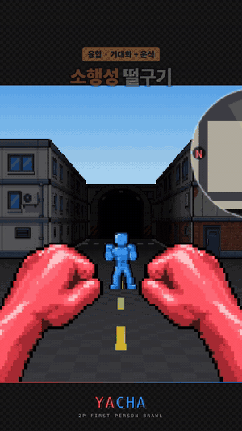
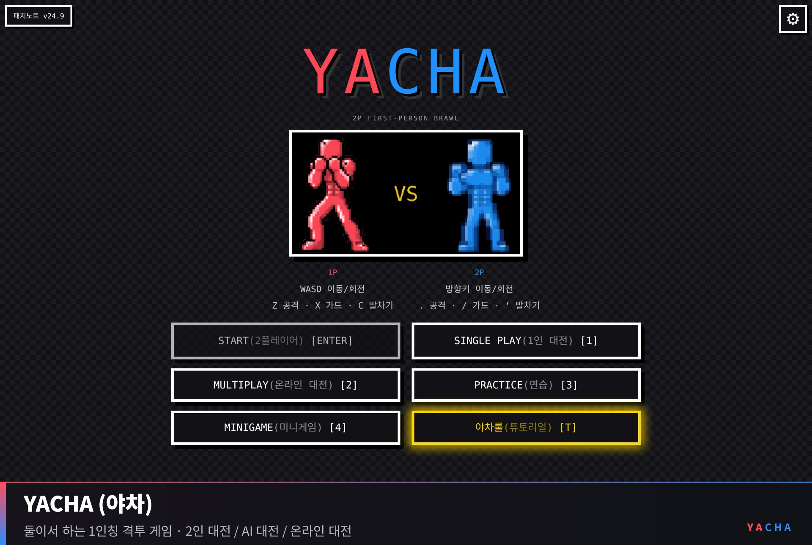
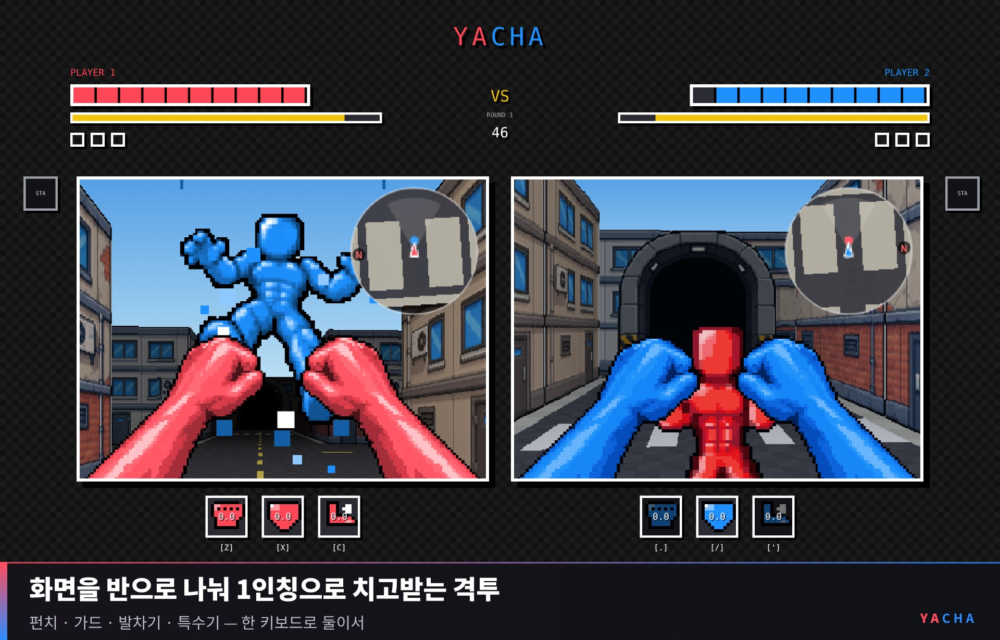
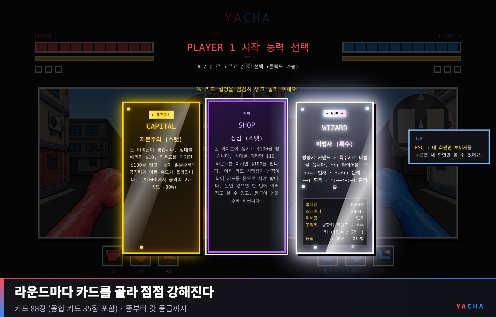
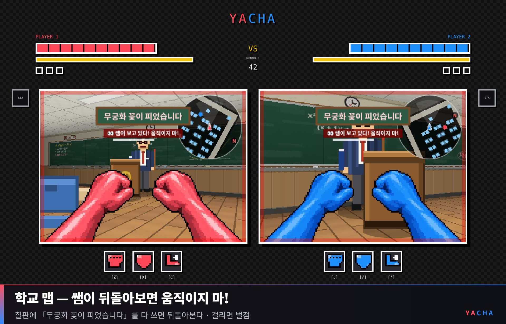
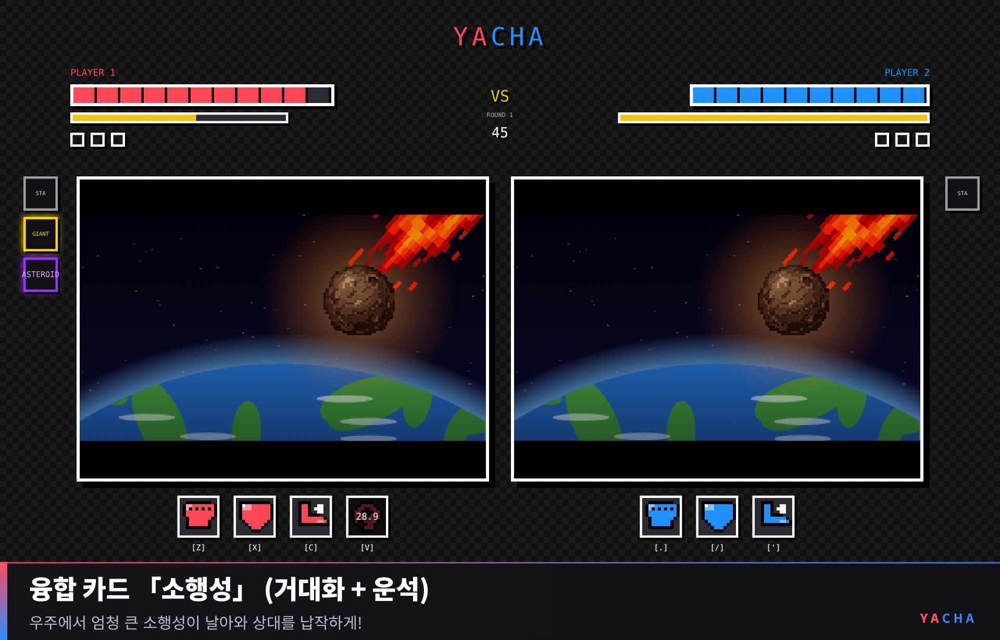
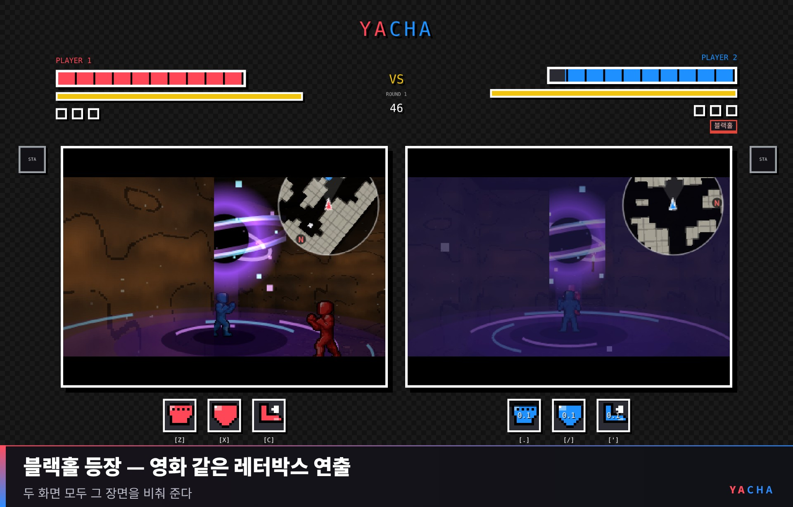
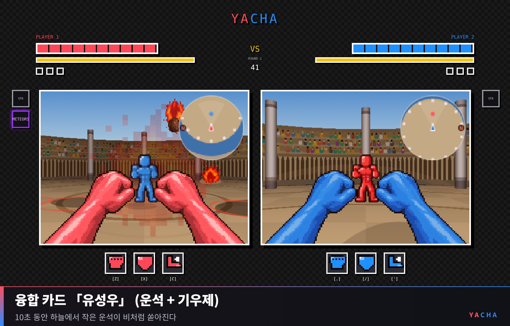

# YACHA (야차)

**둘이서 하는 1인칭 픽셀 격투 게임.** 한 화면을 반으로 나눠 친구랑 치고받아요.
*A 2-player first-person pixel brawler. Split screen, one keyboard.*

## ▶ 바로 플레이

- 웹에서: **https://kimarthur815-collab.github.io/YACHA./**
- 또는 이 저장소의 `index.html` 을 내려받아 브라우저로 열면 바로 실행돼요. (설치 필요 없음)
- 폰에서도 터치 버튼으로 할 수 있어요.

## 홍보 영상

[릴스용 홍보 영상 보기 (23초, mp4)](media/YACHA_reels.mp4)

## 특징

- **모드:** 2인 대전 (한 키보드) · AI 대전 · 온라인 대전 · 연습 · 미니게임 · 튜토리얼
- **카드 88장** (융합 카드 35장 포함): 라운드마다 카드를 골라 강해지고, 두 장을 모으면 융합 카드가 돼요.
- **맵 8개:** 건물 · 콜로세움 · 도시 · 백룸 · 타일 · 시장 · 동굴 · 학교
- **학교 맵:** 쌤이 칠판에 "무궁화 꽃이 피었습니다"를 다 쓰고 뒤돌아보면, 움직이거나 싸우면 벌점!

## 조작

| | 이동/회전 | 공격 | 가드 | 발차기 | 특수 |
|---|---|---|---|---|---|
| 1P | WASD | Z | X | C | V |
| 2P | 방향키 | . | / | ' | ; |

## 스크린샷

| | |
|---|---|
|  |  |
|  |  |
|  |  |
|  | |

## 관련 게임

- 공포 게임 **백룸: 잃어버린 기억** → https://bakkas.itch.io/back-room

---

현재 버전: **v24.9**
